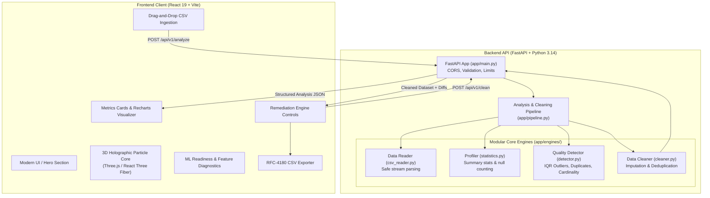

# DataDoctor AI — System Architecture

## Overview
DataDoctor AI is an enterprise data quality inspection, profiling, and remediation platform. It decouples high-performance client-side rendering (React 19, Three.js, Lucide, Recharts) from a modular, Python/FastAPI backend analytical engine.

## Architectural Tenets

1. **Defensive Ingestion**:
   - Files are validated at the API boundary (size check, extension validation, empty payload detection) before disk storage or Pandas parsing.
2. **Stateless Processing**:
   - The backend holds no long-term persistent session state. Temporary files are isolated in OS temp directories and unlinked immediately in `finally` blocks.
3. **Immutability**:
   - Neither profiling nor cleaning ever alters the user's uploaded source file. DataFrames are processed as functional copies.
4. **Honest ML Diagnostics**:
   - The application explicitly distinguishes dataset feature readiness diagnostics (cardinality, null ratios, numeric distributions) from active ML model training. It never fabricates accuracy or training scores without an underlying model.
5. **Progressive Enhancement & Resilience**:
   - The 3D WebGL core includes an automatic fallback error boundary for low-power or mobile environments, respecting user accessibility and system performance.

